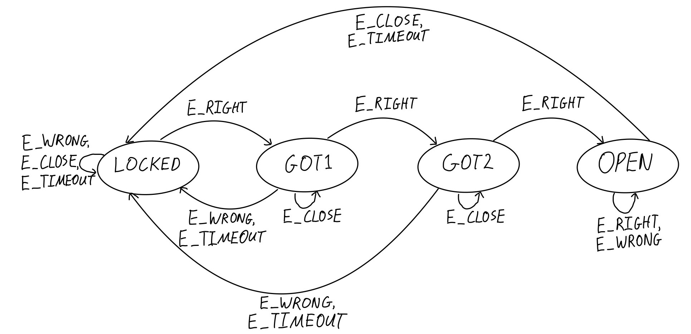

# hw05: Combination Lock

`lock.c` implements a combination lock as a finite state machine (FSM). The
lock opens when the digits `3`, `1`, `4` are entered in order. The FSM's
behavior is defined entirely by a transition table, `lock_table`, which maps
each state and event to a next state and an action.

| Module               | Purpose                                                      |
|----------------------|--------------------------------------------------------------|
| `lock.h` / `lock.c`  | `lock_table`, `lock_step`, `lock_event`, `state_name`, `event_name`, and `action_name` |
| `main.c`             | Runs the characters of `stdin` through the FSM and prints each transition |
| `tests/test_lock.c`  | Unit tests for the transition table, `lock_event`, and whole input sequences |

## Building and Testing

```sh
make         # compile lock.c and main.c, link ./lock
make test    # compile lock.c and tests/test_lock.c, link and run tests/test_lock
make clean   # remove all .o files, ./lock, and tests/test_lock
```

Everything is compiled with `gcc -std=c11 -Wall -Wextra -Wshadow
-fsanitize=address`. Each `.o` file is rebuilt when its `.c` file or `lock.h`
changes.

**`./lock`** starts in `LOCKED` and reads `stdin` one character at a time, for
example `./lock < data/codes.txt`. Characters that are not events (such as
spaces and newlines) are skipped. For each event, it prints one line:

```
<state> <input character> <event> -> <next state> <action>
```

After the end of the input, it prints a last line:

```
final: <state>
```

For example, `echo '3 1 4 c' | ./lock` prints:

```
LOCKED 3 RIGHT -> GOT1 NONE
GOT1 1 RIGHT -> GOT2 NONE
GOT2 4 RIGHT -> OPEN UNLOCK
OPEN c CLOSE -> LOCKED LOCK
final: LOCKED
```

**`tests/test_lock`** tests:

- All 16 entries of the transition table, through `lock_step`.
- `lock_event` with the correct digit and a wrong digit in `LOCKED`, `GOT1`,
  and `GOT2`. Each wrong digit is one that is correct in another state.
- `lock_event` with a digit from the code and another digit while `OPEN`, both
  of which are `E_WRONG`.
- `lock_event` with `'c'`, `'t'`, and a character that is not an event.
- The sequences `"3 1 4"`, `"3 3 1 4"`, `"3 1 t 4"`, and `"3 1 4 c"` from
  `LOCKED`, checking the final state and the last action.

Each test prints `[PASS]` or `[FAIL]`, then the expected and actual results on
the next two lines, followed by a blank line. At the end it prints a summary of
how many tests passed and failed, and exits with a non-zero status if any test
failed.

## lock.h

### Types

| Type           | Values                                                   |
|----------------|----------------------------------------------------------|
| `state_t`      | `LOCKED`, `GOT1`, `GOT2`, `OPEN`                         |
| `event_t`      | `E_RIGHT`, `E_WRONG`, `E_CLOSE`, `E_TIMEOUT`             |
| `action_t`     | `A_UNDEFINED`, `A_NONE`, `A_UNLOCK`, `A_LOCK`, `A_BEEP`  |
| `transition_t` | A struct holding a `next` state and an `action`          |

Each enum ends with a count (`N_STATES`, `N_EVENTS`, `N_ACTIONS`), so its valid
values are 0 up to but not including the count.

| Event       | Input                                     |
|-------------|-------------------------------------------|
| `E_RIGHT`   | The correct next digit of the code        |
| `E_WRONG`   | Any other digit                           |
| `E_CLOSE`   | `'c'`: the door closing                   |
| `E_TIMEOUT` | `'t'`: the timer for entering the code running out |

### Transition Table

`lock_table[s][e]` holds the next state and action for state `s` and event
`e`:

|        | E_RIGHT          | E_WRONG          | E_CLOSE          | E_TIMEOUT       |
|--------|------------------|------------------|------------------|-----------------|
| LOCKED | GOT1, A_NONE     | LOCKED, A_BEEP   | LOCKED, A_NONE   | LOCKED, A_LOCK  |
| GOT1   | GOT2, A_NONE     | LOCKED, A_BEEP   | GOT1, A_NONE     | LOCKED, A_LOCK  |
| GOT2   | OPEN, A_UNLOCK   | LOCKED, A_BEEP   | GOT2, A_NONE     | LOCKED, A_LOCK  |
| OPEN   | OPEN, A_NONE     | OPEN, A_NONE     | LOCKED, A_LOCK   | LOCKED, A_LOCK  |

### State Diagram



### `lock_step`

```c
state_t lock_step(state_t s, event_t e, action_t *action);
```

Steps to the next state and determines the action, by looking up the current
state and event in the transition table.

| Parameter | Description                                                   |
|-----------|---------------------------------------------------------------|
| `s`       | The current state of the FSM. `0 <= s < N_STATES`.            |
| `e`       | The event to react to. `0 <= e < N_EVENTS`.                   |
| `action`  | Where to store the resulting action. Must not be NULL.        |

**Returns:** The next state.

**Errors:** If `s` or `e` is out of bounds or `action` is NULL, an error is
printed to `stderr` and the current state `s` is returned. `*action` is not
changed.

### `lock_event`

```c
int lock_event(state_t s, char c);
```

Determines the event for an input character in the current state. A digit is
`E_RIGHT` if it is the correct next digit of the code and `E_WRONG` otherwise.
`'c'` is `E_CLOSE` and `'t'` is `E_TIMEOUT`.

| Parameter | Description                                            |
|-----------|--------------------------------------------------------|
| `s`       | The current state of the FSM. `0 <= s < N_STATES`.     |
| `c`       | The character to read the event from.                  |

**Returns:** The event's value as an `int`, or -1 if `c` is not a digit, `'c'`,
or `'t'`.

**Errors:** If `s` is out of bounds, an error is printed to `stderr` and -2 is
returned.

### `state_name`

```c
const char *state_name(state_t s);
```

Gets the name of a state as a string, such as `"LOCKED"`.

| Parameter | Description                                     |
|-----------|-------------------------------------------------|
| `s`       | The state to name. `0 <= s < N_STATES`.         |

**Returns:** The state's name, or `"?"` if `s` is out of bounds.

### `event_name`

```c
const char *event_name(event_t e);
```

Gets the name of an event as a string, without the `E_` prefix, such as
`"RIGHT"`.

| Parameter | Description                                     |
|-----------|-------------------------------------------------|
| `e`       | The event to name. `0 <= e < N_EVENTS`.         |

**Returns:** The event's name, or `"?"` if `e` is out of bounds.

### `action_name`

```c
const char *action_name(action_t a);
```

Gets the name of an action as a string, without the `A_` prefix, such as
`"UNLOCK"`.

| Parameter | Description                                     |
|-----------|-------------------------------------------------|
| `a`       | The action to name. `0 <= a < N_ACTIONS`.       |

**Returns:** The action's name, or `"?"` if `a` is out of bounds.
